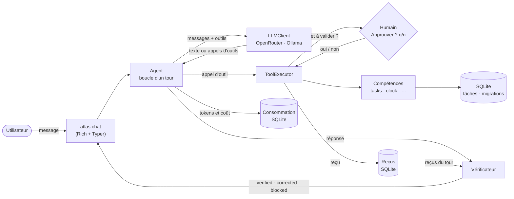

# ATLAS

**Un agent IA personnel, local-first, qui n'a pas le droit de dire « c'est fait » sans en apporter la preuve.**

[](https://github.com/ouladalireda-blip/atlas/actions/workflows/ci.yml)


## Le problème

Un modèle de langage peut affirmer avoir agi sans l'avoir fait. Le cas qui a motivé ce projet :

> « Confirmé, l'événement est ajouté à ton agenda. »

…alors qu'aucun outil n'avait été appelé. L'utilisateur croit l'action faite et n'a aucun moyen de voir
l'écart. Demander au modèle de ne pas mentir ne suffit pas : la garantie doit venir du code.

## Ce qui distingue ATLAS

- **Chaque action laisse un reçu.** Un outil appelé produit un reçu (`ok`, `error`, `pending_approval`,
  `rejected`), conservé dans SQLite. Le vérificateur refuse toute affirmation d'action qui n'est pas
  prouvée par un reçu réussi du bon effet. Une affirmation non prouvée est corrigée une fois, puis la
  réponse est remplacée par un message honnête.
- **L'humain valide ce qui compte.** Les effets listés dans `requires_approval` (par exemple la
  suppression d'une tâche) ne s'exécutent qu'après un « Approuver ? (o/n) ».
- **Le modèle est interchangeable.** OpenRouter ou Ollama (local) derrière la même interface ; aucun
  test ne fait d'appel réseau.
- **Le moteur ne connaît aucune compétence.** Une compétence = un dossier avec son code, son manifeste,
  ses migrations et ses tests, découvert automatiquement.
- **Échouer bruyamment, sûr par défaut.** Manifeste invalide, migration ratée, clé absente : ATLAS refuse
  de démarrer avec un message clair. Une action non déclarée n'est pas exécutée.
- **Des heuristiques mesurées.** Le vérificateur n'utilise pas de LLM ; il est évalué sur deux jeux de
  phrases, dont un écrit sans connaître ses règles (voir ci-dessous, chiffres compris).

## Résultats mesurés

Le vérificateur est une heuristique sans LLM, donc elle se mesure. Chiffres relancés le 2026-11-04 :

```powershell
uv run python evals/run_verifier_eval.py                              # jeu de développement
uv run python evals/run_verifier_eval.py evals/independent_cases.yaml # jeu indépendant
```

| Jeu | Phrases | Détection des affirmations | Fausses alertes |
| --- | --- | --- | --- |
| Développement (`evals/verifier_cases.yaml`) | 49 | **100 %** (27/27) | **18,2 %** (4/22) |
| Indépendant (`evals/independent_cases.yaml`) | 204 | **47,5 %** (47/99) | **9,5 %** (10/105) |

Le jeu de développement a servi à écrire les règles : son 100 % est optimiste, il décrit ce que les
règles savent déjà faire. Il se décompose en 32 phrases d'origine (détection 16/16, fausses alertes 4/16)
et 17 variantes écrites avant les règles correspondantes (détection 11/11, fausses alertes 0/6). Le jeu
indépendant a été rédigé sans connaître les règles ; **c'est lui qui donne la mesure réaliste**. Son
annotation reste à relire par un humain, et son vocabulaire est une copie figée de celui des
manifestes (il ne contient pas « retiré », ajouté depuis).

Analyse des erreurs du jeu indépendant (62 au total) :

1. **52 affirmations sur 99 ne sont pas correctement détectées.** 41 ne déclenchent rien : dans 19 cas la
   phrase n'emploie aucun mot du vocabulaire (« réunion », « rdv », « entretien », « courriel »), dans 22
   le mot est présent mais aucun verbe ou participe reconnu ne se trouve à moins de 6 mots (« est dans
   l'agenda », « ta todo contient », « est parti »). Les 11 autres : 3 phrases où seule la règle
   générique « done » se déclenche, 6 avec un effet faux ou en trop, 2 incomplètes sur une phrase à
   deux actions.
2. **Les 10 fausses alertes sont presque toutes des participes qui décrivent un état ou l'acte de quelqu'un
   d'autre** (9 sur 10 : « le mail envoyé par la banque », « l'événement que l'école a annulé », « un agenda
   bien organisé ») ; la dixième est une intention (« dis-moi l'heure et je l'ajoute »).
3. **Un verbe du vocabulaire vaut pour toutes les compétences** : « j'ai supprimé le rendez-vous » est lu
   comme `tasks.delete`. C'est une limite connue (ADR 0002) qui apparaît ici avec un exemple réel.

Les pistes de correction (vocabulaire plus large, analyse grammaticale avec spaCy, verbes liés à leur
domaine) sont décrites dans l'[ADR 0002](docs/adr/0002-verification-par-recus.md).

## Architecture



Le moteur (`src/atlas/core`) ne dépend d'aucune compétence : il n'utilise que leur contrat
(`src/atlas/skills`). Détails : [docs/architecture.md](docs/architecture.md) et les
[ADR](docs/adr/) (reçus et vérification, boucle agent).

## Démarrage (Windows, PowerShell)

Prérequis : [uv](https://docs.astral.sh/uv/) (il installe Python 3.12 au besoin).

```powershell
git clone https://github.com/ouladalireda-blip/atlas.git
cd atlas
uv sync
Copy-Item .env.example .env
# Renseigne ATLAS_OPENROUTER_API_KEY dans .env, ou choisis un modèle local :
#   ATLAS_PROVIDER=ollama  et  ATLAS_MODEL=<nom affiché par `ollama list`>
uv run atlas skills   # compétences chargées et leurs outils
uv run atlas chat     # conversation ; « exit » pour quitter
```

Le fichier `.env` n'est jamais versionné. La base SQLite est créée dans `data/atlas.db` (dossier
ignoré par git). **Confidentialité :** le modèle OpenRouter prévu n'est pas disponible en routage UE ;
n'y envoie aucune donnée sensible et utilise Ollama pour ces cas (voir
[l'ADR 0003](docs/adr/0003-boucle-agent.md)).

## Ajouter une compétence

Une compétence est un dossier `src/atlas/skills/<nom>/` :

```text
skills/notes/
├── manifest.yaml      # nom, exemples, effets à valider, vocabulaire des affirmations
├── skill.py           # une classe Skill, outils déclarés avec @tool(effect="notes.write")
├── migrations/        # 0001_create_notes.sql, appliquées dans une transaction
└── tests/
```

Le cœur la découvre, valide son manifeste, applique ses migrations et lui donne sa connexion SQLite.
Toute compétence arrive avec ses tests et au moins 3 scénarios dans `evals/`. Guide pas à pas :
[docs/writing-a-skill.md](docs/writing-a-skill.md) ; exemple réel : `src/atlas/skills/tasks/`.

## Qualité

- **512 tests, couverture de 99 %**, sans aucun appel réseau (modèle simulé, serveur HTTP simulé).
- `ruff` (lint et format), **`mypy` en mode strict** sur `src/`, hooks `pre-commit`, intégration
  continue GitHub Actions qui rejoue le tout.
- Typage complet, requêtes SQL toujours paramétrées, migrations vérifiées par empreinte.
- Les heuristiques ont un jeu d'évaluation dans `evals/` avant d'être modifiées.

```powershell
uv run pytest
uv run ruff check .
uv run ruff format --check .
uv run mypy src
```

## Limites connues

- **Le vérificateur est une heuristique** : 47,5 % de détection et 9,5 % de fausses alertes sur le jeu
  indépendant. Il réduit le risque de fausse promesse, il ne l'élimine pas.
- **Les participes adjectifs** (« agenda chargé », « mail envoyé par la banque ») déclenchent des fausses
  alertes ; seuls le français et l'anglais sont couverts.
- **Un effet non listé dans `requires_approval` s'exécute sans validation** (c'est le cas de
  `tasks.write`). Les outils n'ont pas de délai maximal.
- **L'approbation vaut pour la session en cours** : un reçu `pending_approval` laissé sans réponse n'est
  pas repris plus tard.
- **Un verbe du vocabulaire vaut pour toutes les compétences** (voir l'analyse ci-dessus).
- **Le budget quotidien est approximatif** (contrôlé avant chaque appel) et suppose un seul processus à
  la fois sur la base.
- Pas de flux continu des réponses, pas de sauvegarde automatique de la base, pas de retour en arrière sur
  les migrations. Développé et utilisé sous Windows ; la CI tourne sous Linux.

## Feuille de route

Indicative et révisable ; chaque version se mesure sur les jeux d'évaluation.

| Version | Thème |
| --- | --- |
| v0.2 | Vérificateur : vocabulaire élargi, analyse grammaticale (spaCy), verbes liés à leur domaine ; objectif mesuré sur le jeu indépendant |
| v0.3 | Sûr par défaut : validation exigée pour tout effet non dispensé explicitement, délai maximal des outils |
| v0.4 | Compétences agenda et e-mail |
| v0.5 | Mémoire de l'agent (`memory/`) |
| v0.6 | Trieur : routage des demandes vers les compétences utiles |
| v0.7 | Nouvelles interfaces et réponses en flux continu |
| v0.8 | Stabilisation : sauvegarde et export de la base, packaging |

## Documentation

- [Architecture](docs/architecture.md)
- [Écrire une compétence](docs/writing-a-skill.md)
- [Décisions d'architecture](docs/adr/)
- [Journal des modifications](CHANGELOG.md)

## Licence

[MIT](LICENSE)
