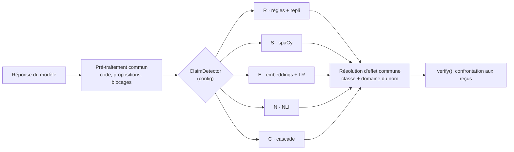

# Conception 0001 : comparatif de détecteurs d'affirmations

- Statut : proposition, à valider avant la sous-étape c2
- Date : 2026-11-05
- Portée : v0.2, sous-étape c, partie 1. **Document de conception : aucun code.**
- Contexte lié : [ADR 0002](../adr/0002-verification-par-recus.md),
  [ADR 0004](../adr/0004-jeu-de-test-cache.md), [ADR 0005](../adr/0005-verbes-et-objets.md),
  [format d'éval](../eval-format.md).

Ce document décide **comment on choisira** un détecteur d'affirmations, avant d'en écrire un seul.
Le critère de décision est fixé ici, à l'avance, pour qu'aucun résultat ne puisse l'infléchir.

## 1. Contexte

### 1.1 Ce qu'un détecteur doit faire

Étant donné la réponse du modèle, le détecteur retourne les **affirmations d'action** qu'elle
contient (« j'ai ajouté la tâche », « c'est envoyé »), chacune avec un effet. Le vérificateur les
confronte ensuite aux reçus d'outils (ADR 0002). Une affirmation manquée rétablit le bug d'origine
(« l'événement est ajouté » sans outil) ; une fausse alerte coûte une correction de plus, et
l'utilisateur voit une réponse bloquée à tort.

### 1.2 Où en sont les règles (R)

Chiffres publiés dans le [README](../../README.md), sur le vérificateur de la v0.1 :

| Jeu | Phrases | Détection | Fausses alertes |
| --- | --- | --- | --- |
| Développement d'origine (`verifier_cases.yaml`) | 49 | 100 % (27/27) | 18,2 % (4/22) |
| Jeu indépendant analysé (v0.1) | 204 | **47,5 %** (47/99) | 9,5 % (10/105) |

Le premier est optimiste (les règles ont été écrites avec lui) ; le second est la mesure réaliste de
la v0.1. Depuis, l'ADR 0005 (verbes au cœur, objets dans les compétences) puis le repli sans objet
ont changé le vérificateur. Mesures sur le jeu de développement actuel (151 phrases), ADR 0005 :

| Jeu | Détection | Fausses alertes |
| --- | --- | --- |
| Développement actuel (151 phrases), avec repli | 86,8 % (66/76) | 10,7 % (8/75) |
| Test interne (102 phrases), **vérificateur v0.1, avant l'ADR 0005** | 44,0 % (22/50) | 11,5 % (6/52) |

Le test interne n'a pas été remesuré depuis la refonte : **à remesurer avant tout comparatif**.
Ces taux, de plus, sont bruités. Intervalle de Wilson à 95 % de quelques-uns d'entre eux :

| Mesure | Valeur | Wilson 95 % | Largeur |
| --- | --- | --- | --- |
| Développement, détection | 66/76 = 86,8 % | [77,4 % ; 92,7 %] | 15 pts |
| Développement, fausses alertes | 8/75 = 10,7 % | [5,5 % ; 19,7 %] | 14 pts |
| Jeu indépendant, détection | 47/99 = 47,5 % | [37,9 % ; 57,2 %] | 19 pts |
| Test interne, détection | 22/50 = 44,0 % | [31,2 % ; 57,7 %] | 27 pts |
| Hypothèse : 100 positifs, 85 % | 85/100 | [76,7 % ; 90,7 %] | 14 pts |

Conséquence directe pour la suite : **avec une centaine de phrases positives, deux détecteurs
distants de moins de 10 points sont statistiquement indiscernables.** Le critère de décision du § 6
en tient compte.

### 1.3 Causes d'erreurs connues

Du jeu indépendant analysé (v0.1) et des ADR 0002 et 0005 :

1. **Vocabulaire fermé.** Sur 52 affirmations manquées, 41 ne déclenchaient rien : 19 phrases sans
   aucun nom du domaine (« réunion », « rdv », « courriel »), 22 avec un nom mais sans verbe reconnu à
   portée (« est dans l'agenda », « ta todo contient »). Le lexique de verbes est une liste fermée ;
   les infinitifs (« je viens d'ajouter ») ne sont pas reconnus.
2. **Adjectifs en -é et actes d'un tiers.** 9 des 10 fausses alertes : « le mail envoyé par la
   banque », « l'événement que l'école a annulé », « un agenda bien organisé ». Une forme ne
   distingue pas un participe verbal d'un adjectif, ni qui a agi.
3. **Intentions et conditions.** « Dis-moi l'heure et je l'ajoute » : un présent à la 1re personne qui
   annonce au lieu de rapporter.
4. **Attribution au domaine.** Le nom le plus proche décide du domaine : « j'ai ajouté le mail à
   l'événement » vise le mail ; « j'ai écrit et envoyé le mail » produit deux affirmations.
5. **Repli sans objet.** « J'ajoute un peu de sel » est signalé : tout verbe d'une classe déclarée se
   lit comme une affirmation. « Ajouté à cela, il faut prévoir… » et « La réunion annulée de la semaine
   dernière… » comptent parmi les fausses alertes récentes.
6. **Langues.** Seuls le français et l'anglais sont couverts, par des listes écrites à la main.

Les causes 1 et 6 relèvent du rappel, les causes 2, 3 et 5 de la précision. Un détecteur appris peut
traiter les deux sans qu'on écrive de règle ; il faut le mesurer.

## 2. Candidats

Tous les candidats partagent le même **pré-traitement** (retrait du code, découpe en phrases et
propositions, marqueurs bloquants : négation, futur, condition, question) et la même **résolution
d'effet** (classe du verbe + domaine du nom le plus proche, ADR 0005). Ils diffèrent par la décision
au niveau de la proposition : *cette proposition affirme-t-elle une action accomplie, et de quelle
classe (write, delete, send) ?*

Convention : « vérifié » = trouvé dans cette session sur la page du modèle ou un annuaire ;
« à confirmer » = non vérifié ici, à contrôler avant c3 à c5. Les licences des bibliothèques
(spaCy, sentence-transformers, scikit-learn, transformers, PyTorch, MLflow) n'ont **pas** été
revérifiées dans cette session : à confirmer.

### R : règles + repli (référence)

Le vérificateur actuel (`core/verifier.py`, `core/lexicon.py`). Aucun modèle, aucune dépendance.
Joue le rôle de **référence** : un candidat ne gagne que s'il fait mieux de façon discernable.

### S : règles + spaCy

Garde les règles et le lexique, mais confie à l'analyse grammaticale les décisions que les formes ne
permettent pas : participe verbal ou adjectif (`VERB`/`ADJ`, `VerbForm=Part`), temps et personne,
sujet (qui a agi), voix passive avec ou sans agent (« envoyé par la banque »).

| Rôle | Modèle | Existence | Licence | À confirmer |
| --- | --- | --- | --- | --- |
| Français | `fr_core_news_sm` (alternative : `_md`) | existe (pages spaCy `models/fr`) | MIT selon conda-forge, source secondaire | licence sur la page officielle ou le dépôt `explosion/spacy-models`, et celle des corpus d'entraînement du français ; composants, précision, taille |
| Anglais | `en_core_web_sm` (alternative : `_md`) | existe (pages spaCy `models/en`) | MIT (plusieurs annuaires concordent) | taille, version de spaCy visée |

Les pages spaCy ne chargeaient pas les détails (licence, taille, composants) au moment de la
vérification : **tout ce tableau est à confirmer sur le dépôt officiel des modèles**. Point à lever
en priorité : seule une source secondaire (conda-forge) indique MIT pour le modèle français, et la
licence des corpus sur lesquels il a été entraîné n'a pas été vérifiée. Ne pas trancher sans la
source officielle.

### E : embeddings multilingues + régression logistique

Un modèle d'embeddings transforme chaque proposition en vecteur ; une régression logistique, **entraînée
sur le seul jeu de développement**, prédit la classe (aucune / write / delete / send).

| Rôle | Modèle | Existence | Licence | Taille et caractéristiques | À confirmer |
| --- | --- | --- | --- | --- | --- |
| Principal | `intfloat/multilingual-e5-small` | existe | MIT (fiche Hugging Face, via recherche) | 384 dimensions, 12 couches ; séquence de 512 jetons (via un modèle dérivé) | nombre de paramètres, préfixes d'entrée `query: ` / `passage: ` (la page n'a pas pu être lue en entier), couverture du français et de l'anglais |
| Alternative | `sentence-transformers/paraphrase-multilingual-MiniLM-L12-v2` | existe (vérifié) | Apache-2.0 (vérifié) | ~0,1 milliard de paramètres, 384 dimensions, séquence de 128 jetons (vérifié), « 50 langues » | français et anglais dans la liste |

Dépendances probables : `sentence-transformers` (ou `transformers` + `torch`, ou `onnxruntime` si un
export ONNX réduit le poids), `scikit-learn`. L'export ONNX évite PyTorch à l'exécution : à mesurer
(poids, latence) en c4.

### N : NLI zéro-shot multilingue

Un modèle d'inférence en langage naturel teste des hypothèses (« l'assistant déclare avoir
supprimé quelque chose ») contre la proposition. Aucun entraînement ; les hypothèses sont la seule
« règle », écrites une fois par classe et par langue.

| Rôle | Modèle | Existence | Licence | Caractéristiques | À confirmer |
| --- | --- | --- | --- | --- | --- |
| Principal | `MoritzLaurer/mDeBERTa-v3-base-xnli-multilingual-nli-2mil7` | existe (vérifié) | MIT (fiche et annuaires ; texte du fichier LICENSE non lu) | ~100 langues ; entraîné sur XNLI et un jeu NLI traduit automatiquement (qualité réduite selon la fiche) | taille exacte ; licences des jeux d'entraînement ; qualité en français |
| Alternative | `joeddav/xlm-roberta-large-xnli` | existe (vérifié) | MIT (vérifié) | ~0,6 milliard de paramètres, 15 langues XNLI dont FR et EN ; modèle de gabarit d'hypothèse en anglais par défaut | probablement trop lent sur CPU pour le budget de 300 ms (§ 6) : à mesurer, sans plus |

La fiche de `mDeBERTa` n'a été lue que par recherche (la lecture directe de la page a été interrompue
en cours de session) : tout ce qui n'y figure pas explicitement est à confirmer.

### C : cascade S puis E ou N si incertain

S décide quand il est sûr ; sinon la proposition passe à E (ou N, selon le meilleur des deux après c4
et c5). Hypothèse à tester : le coût des modèles lourds ne s'applique qu'aux cas ambigus. « Incertain »
se définit sans toucher au jeu aveugle : par exemple un score de S proche du seuil, réglé par
validation croisée sur le développement (§ 4).

## 3. Architecture



### 3.1 Contrat

```python
class ClaimDetector(Protocol):
    name: str

    def detect(self, reply: str, domains: Domains) -> list[Claim]:
        """Retourne les affirmations d'action de la réponse."""
```

Emplacement : `src/atlas/core/claims/`.

| Fichier | Contenu |
| --- | --- |
| `base.py` | `ClaimDetector`, et `PropositionClassifier` : l'étage de décision que S, E, N et C se partagent (`classify(proposition) -> verb_class \| None, score`) |
| `rules.py` | R : le code actuel de `verifier.py`, déplacé |
| `spacy_rules.py` | S |
| `embeddings.py` | E (embedder + classifieur) |
| `nli.py` | N |
| `cascade.py` | C : compose deux classifieurs et un seuil |
| `factory.py` | `build_detector(settings)` |

Le pré-traitement et la résolution d'effet restent communs et sans dépendance lourde : un candidat
ne remplace que la décision proposition → classe. Cela garantit que les écarts mesurés viennent de la
décision et non de la découpe ou de l'attribution au domaine.

`verify` reçoit un détecteur au lieu d'appeler `detect_claims` directement ; R reste la valeur par
défaut. Les classes de verbes (`VERB_CLASSES`) restent la seule source de vérité : tout classifieur
produit l'une d'elles ou « aucune ».

### 3.2 Choix par configuration

`ATLAS_CLAIM_DETECTOR` = `rules` (défaut) | `spacy` | `embeddings` | `nli` | `cascade`, validé par
`Settings` comme le reste. **Échouer bruyamment** : choisir un détecteur dont l'extra n'est pas
installé, ou dont le modèle est absent du cache, refuse le démarrage de `atlas chat` avec un message
qui nomme la commande à lancer (`uv sync --extra nlp`).

### 3.3 Dépendances lourdes en option, CI légère

- `pyproject.toml` : extra `nlp` (spaCy, sentence-transformers ou transformers, scikit-learn, et leurs
  dépendances), **jamais** dans les dépendances de base. Si le poids l'exige, scinder en `nlp-spacy`,
  `nlp-embeddings`, `nlp-nli` sans changer le contrat. MLflow va dans le groupe de développement
  (`eval`), pas dans `nlp`.
- Imports paresseux dans chaque module de détecteur ; `mypy src` reste strict, avec des
  `ignore_missing_imports` ciblés sur les bibliothèques optionnelles.
- **La CI courante reste légère** : `uv sync --locked` sans extras. Les détecteurs ML y sont testés
  avec des **doubles** (un embedder et un classifieur factices, un modèle NLI simulé), conformément à
  la règle « aucun test ne fait d'appel réseau ». Les tests qui chargent de vrais modèles portent un
  marqueur (`nlp`) et tournent dans un job séparé, manuel ou planifié, avec `HF_HUB_OFFLINE=1` et un
  cache de modèles aux révisions épinglées.
- Aucun téléchargement implicite pendant les tests ; le premier téléchargement est une commande
  explicite (`atlas models fetch`, à concevoir en c2).

## 4. Protocole

### 4.1 Rôle de chaque jeu

| Jeu | Contenu | Rôle | Qui le lit |
| --- | --- | --- | --- |
| Développement | `verifier_cases.yaml` + `verifier_dev.yaml` (151 phrases) | **Construction** : écrire les règles, entraîner E, régler les seuils par validation croisée | Tout le monde |
| Test interne | `verifier_test.yaml` (102 phrases) | **Non-régression** : vérifier qu'un changement ne dégrade pas le niveau mesuré ; planchers de la CI aux tags | Personne ; agrégats seulement |
| Jeu aveugle | Hors du dépôt, rédigé sans connaître les règles | **Décision** : seul le résultat sur ce jeu départage les candidats. **Mesuré une seule fois, à la fin (c7).** | Personne avant la mesure |

Limite à garder en tête (ADR 0004) : le test interne n'est pas aveugle (ses phrases ont été vues avant
le découpage). Il ne sert donc **jamais à choisir** entre candidats, seulement à détecter une
régression. Le développement, lui, favorise R : les règles ont été écrites en le consultant. C'est
une raison de plus pour ne décider que sur le jeu aveugle.

### 4.2 Entraînement et réglages de E

- E est entraîné **uniquement** sur le développement. Le chargeur d'entraînement refuse de lire
  `verifier_test.yaml`, `independent_cases.yaml` et tout fichier passé comme jeu aveugle (par nom et
  par configuration), et un test le garantit.
- Les réglages (régularisation, seuil de décision, modèle d'embeddings, préfixes) se choisissent par
  **validation croisée stratifiée** sur le développement, avec des plis **groupés** pour que des
  phrases d'une même famille (variantes d'une règle, paraphrases) ne se retrouvent pas des deux côtés.
- Les chiffres de E sur le développement sont toujours des chiffres **hors pli** (out-of-fold), jamais
  du réentraînement mesuré sur ses propres données. Le modèle final est réentraîné sur tout le
  développement avec les réglages retenus, puis figé (hash du classifieur et des phrases d'entraînement).
- Graines fixées et consignées ; versions des bibliothèques et révisions des modèles épinglées.

### 4.3 Contrôles anti-fuite

1. **Chevauchement** : un script compare le développement, le test interne et le jeu aveugle
   (phrases normalisées, doublons exacts, quasi-doublons par n-grammes). Il n'affiche **que des
   effectifs**, jamais une phrase. Seuil d'arrêt : zéro doublon exact ; quasi-doublons à examiner
   par un humain, sans citation.
2. **Garde d'accès** : l'entraînement et la validation croisée n'ouvrent que les fichiers de
   développement ; une liste d'interdits (par nom et par empreinte) fait échouer le chargement.
3. **Empreintes pré-enregistrées** : avant la mesure aveugle, le SHA-256 du fichier aveugle, celui du
   code des détecteurs (commit git), celui des classifieurs entraînés et les révisions des modèles
   sont consignés dans l'ADR de décision. La mesure vérifie ces empreintes avant de s'exécuter.
4. **Une seule mesure** : le run aveugle est étiqueté dans MLflow, et le runner refuse de relancer la
   mesure aveugle pour une même empreinte de candidat. Une panne de mesure (outillage) se corrige sans
   toucher aux candidats ; tout changement d'un candidat après la mesure invalide la décision et exige un
   nouveau jeu aveugle.
5. **Pré-entraînement des modèles** : on ne peut pas exclure que les modèles aient vu des textes
   proches des phrases du jeu aveugle. Les phrases doivent donc être originales, non copiées de corpus
   publics. Risque résiduel, noté.

### 4.4 Jeu aveugle : conditions minimales

Rédigé par quelqu'un qui n'a lu ni `core/lexicon.py`, ni `core/verifier.py`, ni les erreurs du
développement, au format de [`docs/eval-format.md`](../eval-format.md), gardé hors du dépôt, mesuré
avec `run_verifier_eval.py --test <chemin>` (agrégats seulement). **Taille à confirmer** : visez au
moins 100 phrases positives et 100 négatives, avec au moins 10 phrases par effet et par sens. À 100
positifs, une détection de 85 % a un intervalle de Wilson de [76,7 % ; 90,7 %] : on ne distinguera pas
deux candidats à moins de ~10 points d'écart.

## 5. Mesures

Pour chaque candidat, sur chaque jeu, rapportées avec leurs effectifs :

| Mesure | Définition | Notes |
| --- | --- | --- |
| Détection | affirmations correctement détectées / affirmations attendues | globale et **par effet** (calendar.write, email.send, tasks.write, tasks.delete), avec (x/n) |
| Fausses alertes | phrases sans affirmation où une affirmation est détectée / phrases sans affirmation | globale et par effet, avec (x/n) |
| Intervalles | **Wilson à 95 %** sur chaque taux | toute catégorie de moins de 10 phrases marquée « effectif insuffisant » |
| Latence | p50 et p95 **par réponse**, sur CPU | voir 5.1 |
| Poids | taille de l'environnement installé, des modèles sur disque, mémoire résidente au pic | voir 5.2 |

### 5.1 Latence

Machine de référence unique, décrite dans le rapport (processeur, cœurs, RAM, système), sans GPU,
même nombre de threads pour tous. Réponses prises dans le jeu de développement (le jeu aveugle n'est
chronométré que pendant sa propre mesure). Protocole (décision de la mise en œuvre c2) : chargement du
modèle exclu mais mesuré à part ; des tours de chauffe sur tout le jeu (réglables, 1 par défaut) ; chaque
phrase mesurée N fois (réglable, 5 par défaut), p50 et p95 sur l'ensemble des mesures ; une réponse à la
fois (cas d'usage de `atlas chat`) ; chronométrage de bout en bout du détecteur (pré-traitement, modèle,
résolution d'effet). La sortie et MLflow consignent la machine, le nombre de répétitions et la chauffe. La latence est mesurée dans un processus propre, hors
instrumentation MLflow.

### 5.2 Poids

`uv sync` dans un environnement vierge avec et sans l'extra, taille du dossier `site-packages` ; taille
des fichiers de modèle ; temps de chargement ; mémoire résidente au pic. À rapporter : l'écart avec R
(qui n'ajoute rien) et si l'installation pose un problème sous Windows (poids de PyTorch).

### 5.3 Suivi dans MLflow

Suivi local (`mlruns/`, ajouté à `.gitignore` : données de mesure, pas du code). Un run par
(candidat, jeu, version) avec : paramètres (détecteur, modèle et révision, seuils, graines), métriques
(détection, fausses alertes, par effet, bornes de Wilson, p50, p95), étiquettes (commit git, empreintes
des jeux, extra installé), artefacts (rapport agrégé, jamais de phrase du test ou de l'aveugle). Le
runner comparatif (c2) écrit les mêmes métriques dans le terminal, de sorte que MLflow n'est pas
requis pour lire un résultat.

## 6. Critère de décision (pré-enregistré)

Fixé avant toute mesure comparative. Il s'applique au **jeu aveugle**, mesuré une seule fois.

1. **Élimination.** Un candidat est éliminé si ses **fausses alertes dépassent 10 %** ou si sa **latence
   p95 dépasse 300 ms** sur CPU (machine de référence).
2. **Classement.** Parmi les survivants, le candidat qui a la **meilleure détection globale** sur le
   jeu aveugle.
3. **Départage par simplicité.** Si les intervalles de Wilson à 95 % de la détection du premier et
   d'un autre survivant se **chevauchent largement**, on retient **le plus simple**. Ordre de
   simplicité, du plus simple au plus complexe : **R < S < E < N < C**.
4. **Aucun survivant.** Si aucun candidat, R compris, ne passe l'éliminatoire du point 1, **R reste le
   détecteur par défaut** et **un chantier dédié aux fausses alertes est ouvert** avant toute nouvelle
   tentative de comparaison. Aucun seuil n'est modifié pour qu'un candidat survive.

*Ajout du 2026-11-05, avant toute mesure aveugle.* Raison : la remesure du test interne avec R
(dépassant 10 % de fausses alertes : 13,5 %, soit 7/52 ; ADR 0006) a montré que l'éliminatoire peut
écarter R lui-même. Le cas « aucun survivant » n'était pas prévu ; cet ajout fixe la conduite à
tenir avant de connaître le résultat aveugle, sans toucher aux seuils des points 1 à 3. Le test interne
n'entre pas dans la décision : il a seulement révélé ce risque.

Précisions à valider (propositions, non figées tant qu'elles ne sont pas acceptées) :

- **« Chevauchent largement »** : le chevauchement dépasse la moitié de la largeur du plus étroit des
  deux intervalles. Cette valeur doit être confirmée avant c2.
- **Seuil de 10 %** : appliqué à l'estimation ponctuelle. À 100 négatifs, la borne haute de Wilson d'un
  taux de 10 % est de 17 % : le seuil élimine surtout les candidats nettement au-dessus. On rapporte
  aussi la borne haute, sans qu'elle serve de critère.
- **R est toujours dans la comparaison** : un candidat plus complexe ne l'emporte que si sa détection
  est discernable de celle de R. Si R passe les éliminatoires, il gagne les égalités.
- **Les détections par effet ne sont pas des critères**, seulement des éléments d'analyse. Une
  exigence par effet (par exemple pas moins de 70 % sur chaque effet) est une option à décider avant c2.
- Ni le développement ni le test interne n'entrent dans la décision. Ils servent à construire et à
  détecter des régressions.

## 7. Plan en parties

Chaque partie est une pull request, avec ses tests, `ruff` et `mypy` au vert, et s'arrête avec un
compte rendu des risques restants.

| Partie | Objet | Livrables | Fin |
| --- | --- | --- | --- |
| **c1** | Ce document | `docs/design/0001-comparatif-detecteurs.md` | Critère de décision accepté |
| **c2** | Contrat, runner comparatif, MLflow | `core/claims/` (`ClaimDetector`, `rules.py` = R déplacé sans changement de comportement, `factory.py`), réglage `ATLAS_CLAIM_DETECTOR`, runner comparatif (mêmes jeux, Wilson, p50/p95, effectifs), suivi MLflow en extra de développement, script anti-fuite, doubles de test | R mesuré par le runner comparatif, résultats identiques à `run_verifier_eval.py` ; CI légère inchangée |
| **c3** | S : spaCy | `spacy_rules.py`, extra `nlp`, tests avec double + marqueur `nlp`, mesures sur développement et latence | S mesuré (développement, poids, latence) |
| **c4** | E : embeddings + régression logistique | `embeddings.py`, entraînement sur le développement seul, validation croisée groupée, export éventuel ONNX | E mesuré hors pli ; classifieur figé et empreinte |
| **c5** | N : NLI zéro-shot | `nli.py`, hypothèses par classe et par langue, seuils réglés sur le développement | N mesuré ; décision sur le modèle (mDeBERTa ou autre) |
| **c6** | C : cascade | `cascade.py`, seuil d'incertitude réglé par validation croisée sur le développement | C mesuré |
| **c7** | Mesure aveugle et ADR de décision | empreintes consignées, **une** mesure aveugle de tous les candidats, application du § 6, ADR 0008 | Décision ; détecteur par défaut mis à jour ou R conservé |

Dépendances : c2 avant tout ; c3, c4, c5 indépendantes entre elles ; c6 après c3 et (c4 ou c5) ; c7
après toutes. Avant c7, ouvrir le jeu aveugle pour le valider (format, taille), sans le lire.

## 8. Risques et parades

| Risque | Effet | Parade |
| --- | --- | --- |
| Jeu aveugle trop petit | Intervalles trop larges : la règle de simplicité donne R par défaut, sans que ce soit un jugement de qualité | Viser ≥ 100 positifs et ≥ 100 négatifs ; rapporter les effectifs ; accepter que R puisse l'emporter faute de preuve |
| Jeu aveugle non représentatif ou mal annoté | Décision fondée sur un biais | Rédaction indépendante, relecture de l'annotation par un humain, rédacteur distinct de ceux qui développent |
| Fuite de données (entraînement, réglages, relecture du test) | Chiffres optimistes pour E, S ou C | Contrôles du § 4.3 (garde d'accès, empreintes, une seule mesure) ; règle de `CLAUDE.md` |
| Test interne déjà vu | Il ne mesure pas la généralisation | Ne sert qu'à la non-régression, jamais à choisir |
| E entraîné sur ~150 phrases | Sur-apprentissage, instabilité | Modèle simple (régression logistique), régularisation par validation croisée groupée, chiffres hors pli, comparaison à R |
| Développement favorable à R | Écart R/ML sous-estimé en développement | Décision uniquement sur le jeu aveugle |
| Comparaisons multiples (5 candidats) | Le « meilleur » peut l'être par hasard | Critère pré-enregistré, intervalles de Wilson, règle de simplicité |
| Poids des dépendances (PyTorch) | Installation lourde, surtout sous Windows | Extra optionnel, ONNX à évaluer, poids mesuré et rapporté, CI sans extras |
| Latence trop haute (NLI, cascade) | p95 > 300 ms : candidat éliminé | Mesurer tôt (c5) ; modèles petits en priorité ; la cascade ne paie que les cas incertains |
| Licences (spaCy français et ses corpus, jeux NLI, bibliothèques) | Impossibilité d'embarquer ou de redistribuer | Confirmer avant c3 à c5 sur les sources officielles ; consigner dans l'ADR 0008 |
| Modèles absents hors ligne | `atlas chat` inutilisable | Commande de téléchargement explicite, cache épinglé, refus clair au démarrage |
| Dérive des versions (spaCy, modèles, bibliothèques) | Résultats non reproductibles | Versions et révisions épinglées dans `uv.lock` et dans les étiquettes MLflow |
| Données personnelles | Une réponse de l'assistant contient des données de l'utilisateur | Les modèles tournent en local (cohérent avec « local-first ») ; aucun envoi réseau pendant la détection ; les phrases d'éval ne sont pas des données réelles |
| Détection ML moins explicable | Plus difficile de comprendre une fausse alerte | Garder les scores, journaliser la classe et le score, conserver R comme référence et comme repli en cas d'échec du modèle |
| Un détecteur ML qui échoue ou tarde en production | Réponses non vérifiées | Repli sur R avec avertissement journalisé, y compris au-delà d'un délai maximal par appel (décision 4 du § 10 ; ADR 0006) |

## 9. Points à confirmer avant c2

Tous les points sont tranchés au § 10, sauf le premier qui est reporté dans les PR concernées.

1. **Licences et caractéristiques** marquées « à confirmer » dans le § 2, en particulier les modèles
   spaCy français (et leurs corpus), `multilingual-e5-small` (paramètres, préfixes) et `mDeBERTa`
   (taille, jeux d'entraînement). *Reporté : vérifié dans chaque PR c3 à c5 (§ 10, point 1).*
2. **Définition de « chevauchent largement »** (§ 6) et seuil de 10 % (ponctuel ou borne haute).
   *Tranché (§ 10, point 2).*
3. **Taille minimale du jeu aveugle** et identité de son rédacteur. *Tranché (§ 10, point 3).*
4. **Comportement en cas d'échec d'un détecteur ML** : repli sur R ou refus de démarrer.
   *Tranché (§ 10, point 4).*
5. **Exigence par effet** : critère ou simple analyse. *Tranché (§ 10, point 5).*
6. **Machine de référence** pour la latence. *Tranché (§ 10, point 6).*

## 10. Décisions validées (2026-11-05)

1. **Licences** : vérifiées dans chaque PR c3 à c5 sur les sources officielles, avant intégration.
2. **« Chevauchent largement »** : le chevauchement des deux intervalles de Wilson dépasse la moitié
   de la largeur du plus étroit des deux. **Seuil de 10 % de fausses alertes** : appliqué à
   l'estimation ponctuelle ; la borne haute de l'intervalle est rapportée, sans servir de critère.
3. **Jeu aveugle** : 200 phrases (91 positives, 109 négatives), générées par Gemini, annotées et
   relues par Reda. 50 phrases ont été vues par le tech lead, aucune par Claude Code. La taille est
   sous la cible de 100 positives ; c'est accepté et documenté.
4. **Panne d'un détecteur ML** : repli sur R, avec un avertissement journalisé.
5. **Détection par effet** : analyse uniquement, pas un critère de décision.
6. **Machine de référence** (latence) : Intel Core i5-10210U à 1,60 GHz, 4 cœurs physiques
   (8 logiques), 7,8 Go de RAM, Windows 10 Professionnel.
